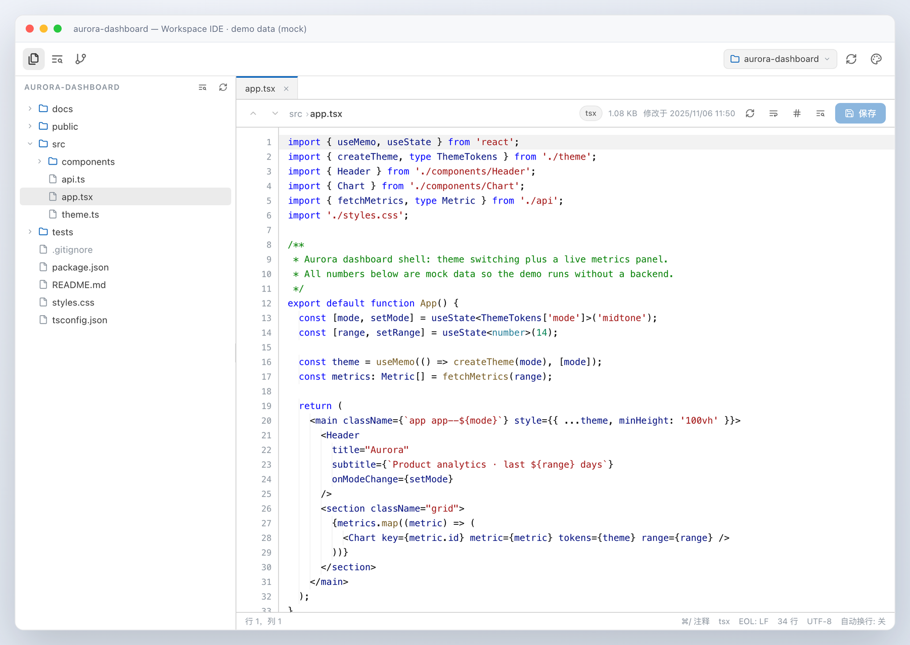
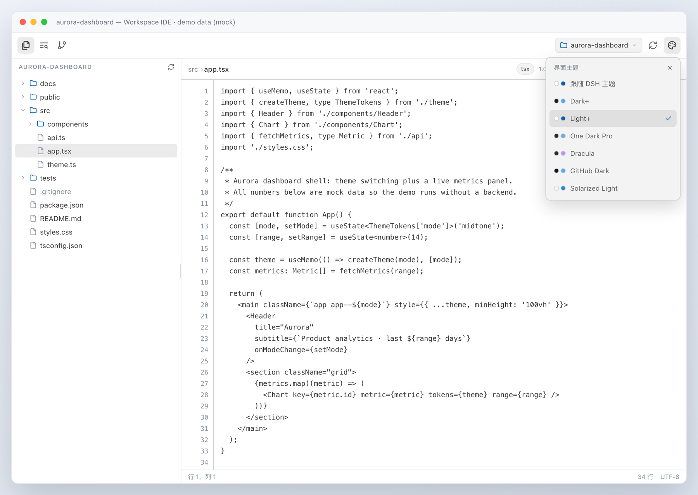
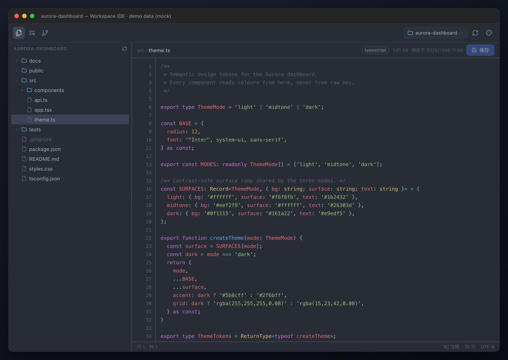
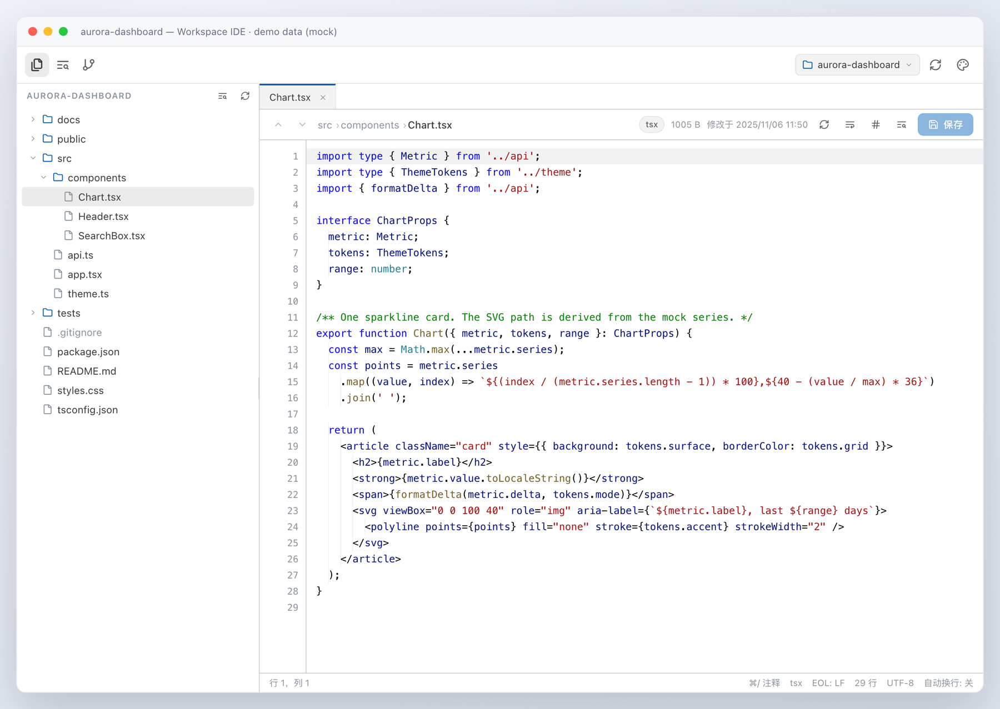
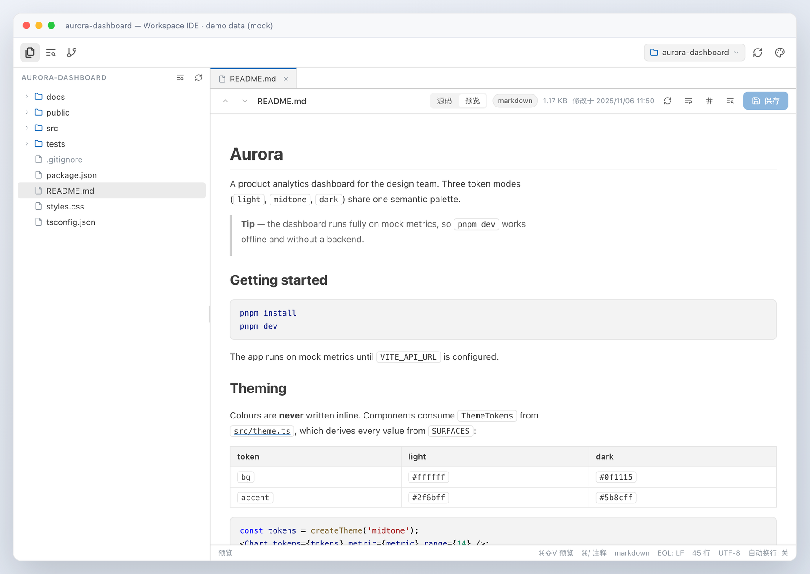
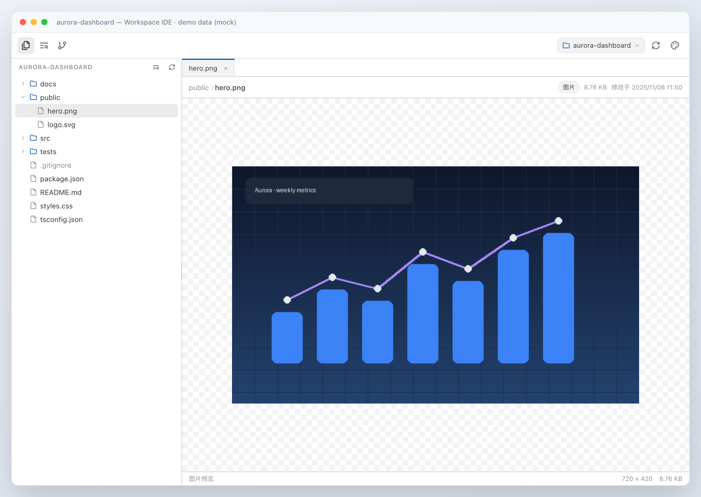
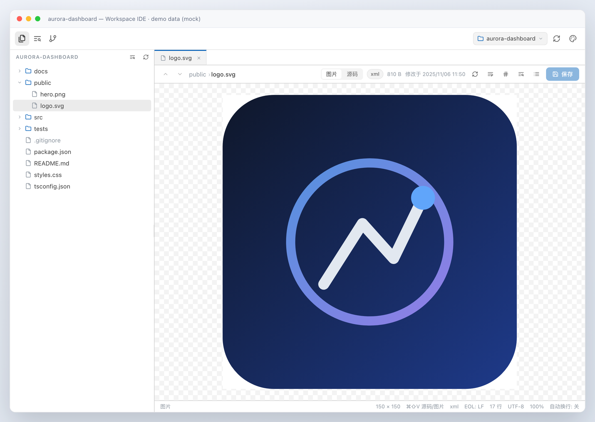
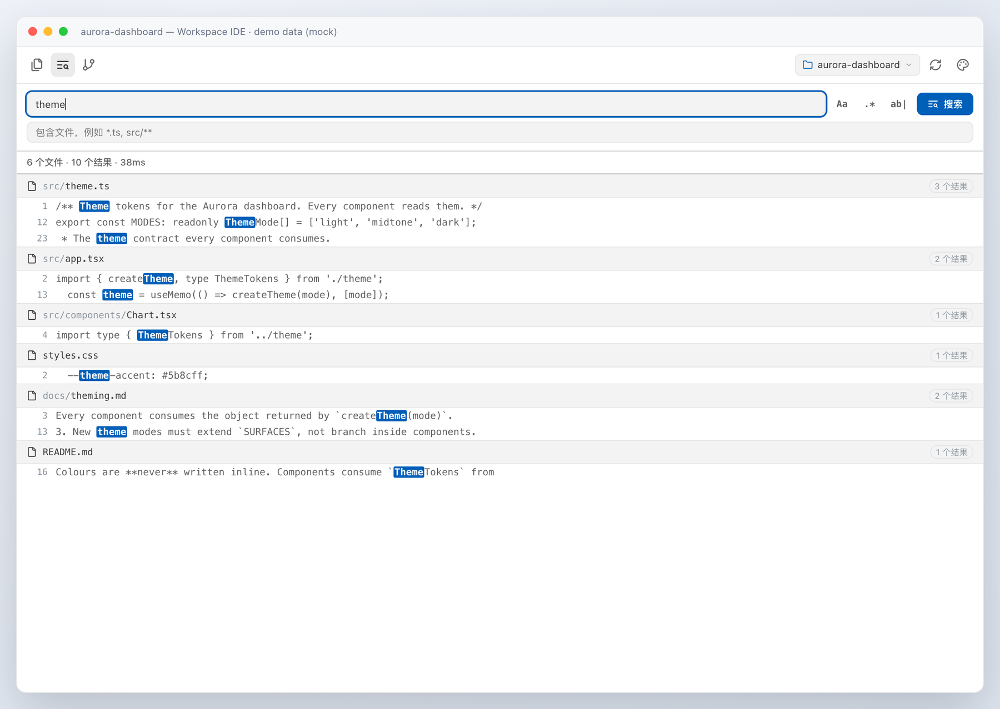
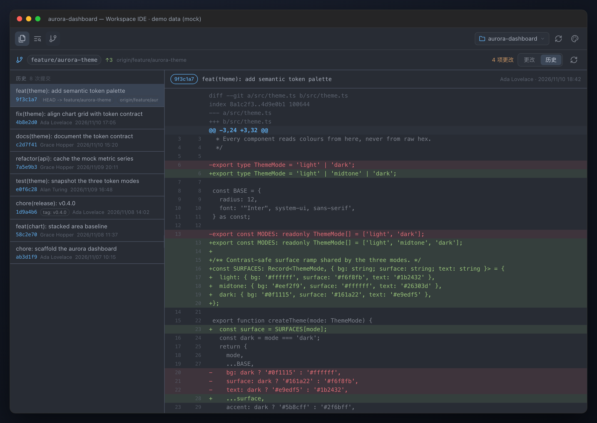
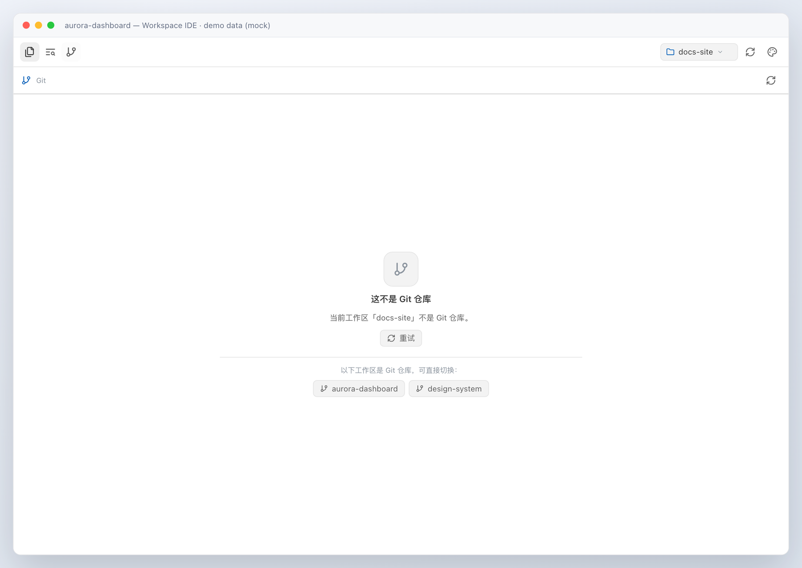

# dsh-workspace-ide

[](https://github.com/echoVic/dsh-workspace-ide/actions/workflows/test.yml)
[](LICENSE)

A VS Code-like workspace panel plugin for
[DeepSeek Harness](https://github.com/deepseek-ai/deepseek-harness) (DSH): browse the
workspace, search it, and read its git state without leaving the conversation.



| Surface | What it does |
|---|---|
| **Files** | Lazy directory tree for the whole workspace, resizable split, line-numbered **syntax-highlighted** code viewer, inline editing with `Ctrl/Cmd+S` save and `Cmd/Ctrl+/` comment toggling, rendered **Markdown preview** with source toggle, **image / SVG preview**, large-file/binary guards |
| **Search** | Full-text workspace search with case / regex / whole-word toggles and an include filter; hits are grouped per file, highlighted, and jump straight to the matching line in the viewer |
| **Git** | Current branch with ahead/behind, staged / unstaged / untracked / conflicted groups with colourised unified diffs, and a commit history with per-commit diffs; a non-git workspace lists other git workspaces for one-click switching |

### Colour themes

The panel ships the mainstream VS Code palettes and switches between them without touching
the rest of the DSH UI:

| Selection | Palette |
|---|---|
| **Follow DSH theme** (default) | the live `--dsw-alias-*` values, so it matches the app light/dark theme |
| **Dark+** | VS Code's default dark palette |
| **Light+** | VS Code's default light palette |
| **One Dark Pro** | Atom's One Dark |
| **Dracula** | the official Dracula palette |
| **GitHub Dark** | GitHub's dark palette |
| **Solarized Light** | Ethan Schoonover's Solarized Light |



> All screenshots in this README are rendered from a **synthetic demo workspace**
> (`aurora-dashboard`) with mock files, git history and diffs — never real user data.
> They are generated reproducibly by
> [`scripts/screenshots/build-screenshots.py`](scripts/screenshots/build-screenshots.py),
> which mounts the real client bundle against a stubbed fetch layer.

Each theme is a table of `--dsw-alias-*` custom-property overrides scoped to the panel root;
every surface (tree, editor gutter, search highlights, git diff colours, scrollbars) follows
the selection, and the choice is remembered in `localStorage`. The toolbar glyphs are
borderless — an inactive tab is just the icon, the active tab is a rounded background, and
the focus ring appears only for keyboard navigation.




### Syntax highlighting

The editor colours code with a small, dependency-free highlighter written for this panel —
no Shiki/Prism bundle and no extra runtime dependency (the whole browser half still only
requires `react`). It covers every language the Host reports: JavaScript / TypeScript /
JSX / TSX, JSON, Markdown, CSS, HTML/XML, Python, Go, Rust, Java, Kotlin, Swift, C/C++, C#,
Ruby, PHP, Shell, PowerShell, YAML, TOML, INI, SQL, GraphQL and the tag level of
Vue/Svelte; unknown files and files over 300 KB fall back to plain text for rendering speed.

Token colours follow the selected palette: **Follow DSH theme** inherits the app's own
`--shiki-token-*` colours (so it matches the surrounding light/dark UI), and each VSCode
theme ships its own keyword / string / comment / number / function / type / variable table.

The editor stays editable while highlighted: a transparent-text `textarea` sits over the
syntax-coloured layer, with caret, selection, both scroll axes and the line-number gutter
kept in sync. Read-only previews reuse the same coloured rendering.

Editing keeps the VSCode muscle memory: **`Cmd/Ctrl+/` toggles comments** for the current
line or every selected line (the per-language token table covers `//`, `#`, `--`, `;` and
`/* */` / `<!-- -->` block wrapping for CSS, HTML, XML, Markdown, Vue and Svelte), and the
toggle is reversible, indent-preserving and leaves blank lines untouched.

### Markdown preview

`.md` files switch between editable source and a rendered preview from the file header, or
with `Cmd/Ctrl+Shift+V`. The preview is built from React elements — never injected HTML — and
covers headings, fenced code blocks (highlighted by the same engine, in the selected theme),
ordered/unordered and task lists, blockquotes, GFM tables, links, images and rules;
`javascript:`/`data:` URLs are dropped. It renders the current draft, so unsaved edits
preview immediately, and read-only/oversized Markdown files still preview.



### Images and SVG

Raster images (PNG, JPEG, GIF, WebP, BMP, ICO, AVIF) open in a centred preview over a
checkerboard surface, with the file's natural dimensions and size in the status bar. SVGs
get both a rendered preview and editable source, switchable with the `图片 / 源码` toggle or
`Cmd/Ctrl+Shift+V`; the preview is rendered from the current source, so editing the SVG
updates the picture immediately. Image bytes come from a dedicated Host route that verifies
every file against its magic number and caps reads at 8 MiB.





The panel opens from the left rail (**工作区 / Workspace**, next to *Plugins*, *Scheduled
tasks*, *Usage stats*). The three-icon strip at the top switches between Files / Search /
Git — the file-copy, list-search and git-branch activity icons. The workspace picker on
the right follows the session the app is currently viewing, and a manual pick sticks for
that session.







## Install

From a DSH session, install the bundle from this directory with the plugin manager
(absolute path required):

```
plugin_manager {
  action: "install_bundle",
  target: "/absolute/path/to/dsh-workspace-ide"
}
```

The bundle is profile-wide and survives restarts. `application: "applied"` in the result
means it activated immediately; client-side changes are picked up by DSH's client HMR,
host-side changes load on the next Host start.

Or install straight from GitHub instead of a local checkout:

```text
plugin_manager { action: "install_bundle", target: "echoVic/dsh-workspace-ide" }
# or pin a release tarball:
plugin_manager { action: "install_bundle", target: "https://github.com/echoVic/dsh-workspace-ide/archive/refs/tags/v0.3.0.tar.gz" }
```

## How it works

- **Host half** (`lib/index.js`, `lib/host/*.js`): registers eight authenticated fetch
  routes through `ctx.connection.fetch.register` — `workspaces`, `list`, `file`, `image`,
  `search`, `git`, `save`, `ping`. Filesystem access is path-checked (absolute paths, `..` escapes,
  symlink escapes and roots outside known workspaces are rejected); everything is
  read-only except `save` (atomic overwrite of an existing regular file only) and `ping`
  (one diagnostic line in `$DSH_HOME/workspace-ide/status.jsonl`, used by the client to
  prove it executed). Git runs through `child_process.execFile` with bounded output; a
  non-repository root is a normal answer, not an error.
- **Client half** (`lib/client.js`, generated from `src/client/*.js` by
  `scripts/build-client.mjs`): one `window.__ModuleLoader__.load(...)` browser module that
  registers a `sidebar.panellist` icon and the matching keyed `main` panel. It only uses
  `require('react')`, the `--dsw-alias-*` theme tokens (dark and light), a built-in zh/en
  dictionary, and the DSH frame's `--dsh-frame-*` chrome insets; the page is wrapped in an
  error boundary. The panel follows the viewed session's workspace via the slot kit's
  `useWorkspaces` hook, and falls back safely when that hook is absent.
- **Icons**: the whole toolbar/tree/git/theme icon set is the open-source
  [Lucide](https://lucide.dev) set (ISC, with Feather-derived glyphs under MIT). Its SVG
  node data is vendored at authoring time in `src/client/05-icons.js` — no runtime icon
  dependency — and renders through one factory so every glyph shares the 24px grid, round
  caps and `currentColor` stroke. Licenses: [`THIRD_PARTY_NOTICES.md`](THIRD_PARTY_NOTICES.md),
  [`licenses/lucide-LICENSE.txt`](licenses/lucide-LICENSE.txt).

## Development

```bash
npm ci                                 # dev-only tooling: TypeScript type checker
npm run typecheck                      # tsc --checkJs over lib/ + src/client + tests (no emit)
node scripts/build-client.mjs          # rebuild lib/client.js from src/client/*.js
node scripts/build-client.mjs --check  # fail when lib/client.js is stale
node --check lib/client.js
node --test test/host/                      # Host route unit tests (node:test, 118)
node test/smoke/client-smoke.mjs            # headless client module/face smoke test (39 checks)
node --test test/review/*.test.mjs          # independent adversarial + contract suites (78)
python3 scripts/screenshots/build-screenshots.py   # rebuild docs/ screenshots (mock data)
```

TypeScript is used **only as a dev-time type checker**: sources stay plain JavaScript with
JSDoc annotations, `tsc --noEmit --checkJs` checks `lib/`, `src/client/` and the tests
(`types/client-globals.d.ts` declares the shared factory scope and the React element alias).
There is still no client bundler, no build step for the Host and no runtime dependency —
`npm ci` installs `typescript`, `@types/node` and `@types/react` into devDependencies only.

`lib/client.js` is served directly by the Host and DSH's client HMR watches installed
bundle artifacts, so saving a rebuilt `lib/client.js` updates an open Harness page without
a restart.

## Layout

```
lib/index.js             Host plugin entry (`apply`, `inject`, `name`)
lib/host/                filesystem / search / git route implementation
lib/client.js            built browser module (committed)
tsconfig.json            dev-only type checker config (allowJs + checkJs, no emit)
types/                   ambient declarations for the client factory scope
src/client/              browser sources: core, icons (vendored Lucide), highlighter,
                         shell, files, search, git, module face
THIRD_PARTY_NOTICES.md   icon license attribution
licenses/                full third-party license texts
scripts/build-client.mjs  concatenating build + staleness check
test/host/               node:test suites (118 tests)
test/smoke/              headless client-module smoke test (39 checks)
test/review/             independent adversarial + client-contract suites (78 tests)
docs/                    screenshots
```

## License

[MIT](LICENSE) © 2026 echoVic.

The vendored Lucide icon set (and the Feather-derived glyphs inside it) keep their own
licenses — full texts and attribution are in [THIRD_PARTY_NOTICES.md](THIRD_PARTY_NOTICES.md)
and [licenses/](licenses/).
