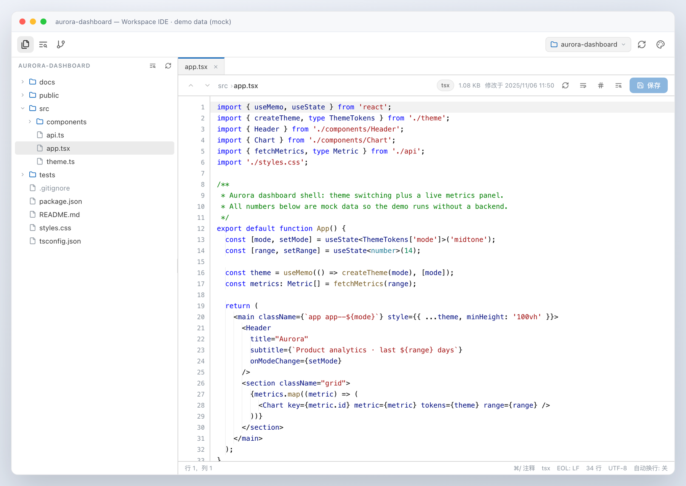
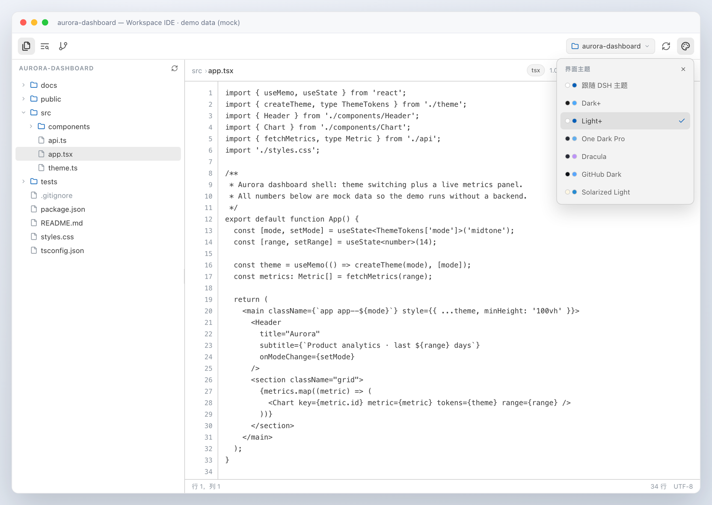

# dsh-workspace-ide

[](https://github.com/echoVic/dsh-workspace-ide/actions/workflows/test.yml)
[](https://www.npmjs.com/package/dsh-workspace-ide)
[](LICENSE)

[简体中文](README.zh-CN.md) | English

A VS Code-like workspace panel plugin for [DeepSeek Harness](https://github.com/deepseek-ai/deepseek-harness) (DSH): browse the workspace, search it, and read its git state without leaving the conversation.

It is published on npm as [`dsh-workspace-ide`](https://www.npmjs.com/package/dsh-workspace-ide); every release is built and published by GitHub Actions through npm trusted publishing (OIDC) with a signed provenance statement.



## Surfaces

- **Files**: a lazy tree for the whole workspace with a resizable split and a line-numbered, syntax-highlighted viewer with git change marks in the gutter. Quick open (`Ctrl/Cmd+P`), in-file find and replace (`Ctrl/Cmd+F` / `Ctrl/Cmd+H`, with case, whole-word and regex modes), multi-tab editing with per-tab drafts and unsaved-change guards, back and forward navigation (`Ctrl/Cmd+Alt+←/→`), editor zoom, bracket matching, auto-pair, indent guides and line moves, comment toggling (`Cmd/Ctrl+/`), Markdown preview with a source toggle, image and SVG preview, and large-file and binary guards. `Ctrl/Cmd+S` saves.
- **Search**: full-text workspace search with case, regex and whole-word toggles plus an include filter; hits are grouped per file, highlighted, and jump to the matching line.
- **Git**: current branch with ahead/behind, staged, unstaged, untracked and conflicted groups with colourised unified diffs, and a commit history with per-commit diffs. Status and log refresh silently while the tab is open and pause when it is hidden; gutter marks refresh after each save. A non-git workspace lists other workspaces for one-click switching.

### Colour themes

The panel ships the mainstream VS Code palettes and switches without touching the rest of DSH: **Follow DSH theme** (the default, live `--dsw-alias-*` values), **Dark+**, **Light+**, **One Dark Pro**, **Dracula**, **GitHub Dark** and **Solarized Light**.



All screenshots are rendered from a synthetic demo workspace.

## Install

From a DSH session, install the published npm package (version-pinnable):

```text
plugin_manager {
  action: "install_bundle",
  target: "dsh-workspace-ide"
}
```

Install straight from GitHub (`main` or a pinned tarball):

```text
plugin_manager { action: "install_bundle", target: "echoVic/dsh-workspace-ide" }
plugin_manager { action: "install_bundle", target: "https://github.com/echoVic/dsh-workspace-ide/archive/refs/tags/v1.8.7.tar.gz" }
```

For plugin development, install the working directory with an absolute path:

```text
plugin_manager { action: "install_bundle", target: "/absolute/path/to/dsh-workspace-ide" }
```

The bundle is profile-wide and survives restarts. `application: "applied"` means it activated immediately; client changes are picked up by DSH's client HMR, and host changes load on the next Host start.

## Platform notes

The host half validates workspace roots against the platform's native spelling, so Windows drives and UNC roots work, and win32 backslashes are normalized to POSIX separators. Shortcut hints say **Cmd/Ctrl**, and typography follows DSH's `--dsw-font-family` and `--ds-font-family-code` tokens, so DSH font settings apply to the panel too.

## How it works

- **Host** (`lib/index.js`, `lib/host/*.js`) registers nine authenticated fetch routes through `ctx.connection.fetch.register`; filesystem access is path-checked, and everything is read-only except `save` (an atomic overwrite of an existing regular file) and `ping`. Git runs through `child_process.execFile` with bounded output.
- **Client** (`lib/client.js`, generated from `src/client/` by `scripts/build-client.mjs`) is one `window.__ModuleLoader__.load(...)` module that registers a `sidebar.panellist` icon and the keyed `main` panel, using only `require('react')`, the DSH theme tokens and a built-in zh/en dictionary.
- **Icons** come from the open-source [Lucide](https://lucide.dev) set, vendored as SVG data with no runtime dependency; licenses are in [THIRD_PARTY_NOTICES.md](THIRD_PARTY_NOTICES.md) and [licenses/lucide-LICENSE.txt](licenses/lucide-LICENSE.txt).

## Development

```bash
npm ci                                 # dev-only tooling: the TypeScript checker
npm run typecheck                      # tsc --checkJs, strict, over lib/ + src/client + scripts + tests
npm run typecheck:host                 # lib/ under noImplicitAny
npm run typecheck:client               # client sources under noImplicitAny
node scripts/build-client.mjs          # rebuild lib/client.js from src/client/
node scripts/build-client.mjs --check  # fail when lib/client.js is stale
node --check lib/client.js
node --test test/host/                 # host route unit tests
node test/smoke/client-smoke.mjs       # headless client module smoke test
python3 scripts/check-screenshots.py   # README screenshots are non-blank renders
```

TypeScript is only a dev-time checker: sources stay plain JavaScript with JSDoc annotations, and `tsc --noEmit --checkJs` checks them with `strict: true`. There is no client bundler, no build step for the host and no runtime dependency. `lib/client.js` is served directly by the host and watched by DSH's client HMR, so saving a rebuilt copy updates an open Harness page without a restart.

## Releases

Pushing a `v*` tag runs [`.github/workflows/publish.yml`](.github/workflows/publish.yml): the tag must match `package.json`, then `npm publish` runs through GitHub OIDC trusted publishing (no npm token in the repository) and npm records build provenance.

## License

[MIT](LICENSE)
