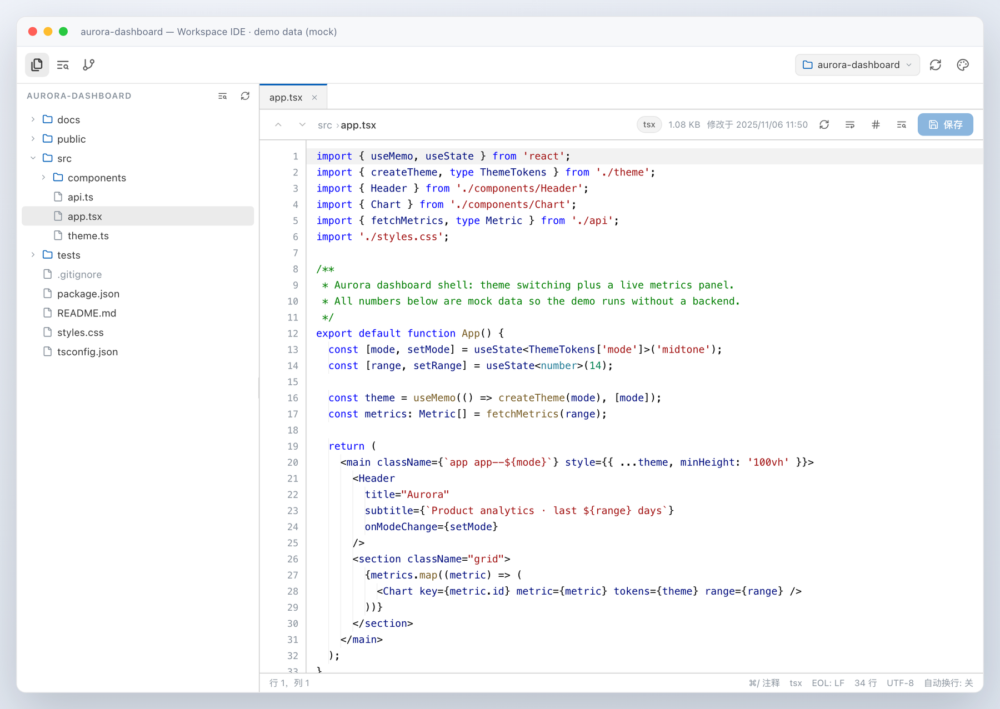
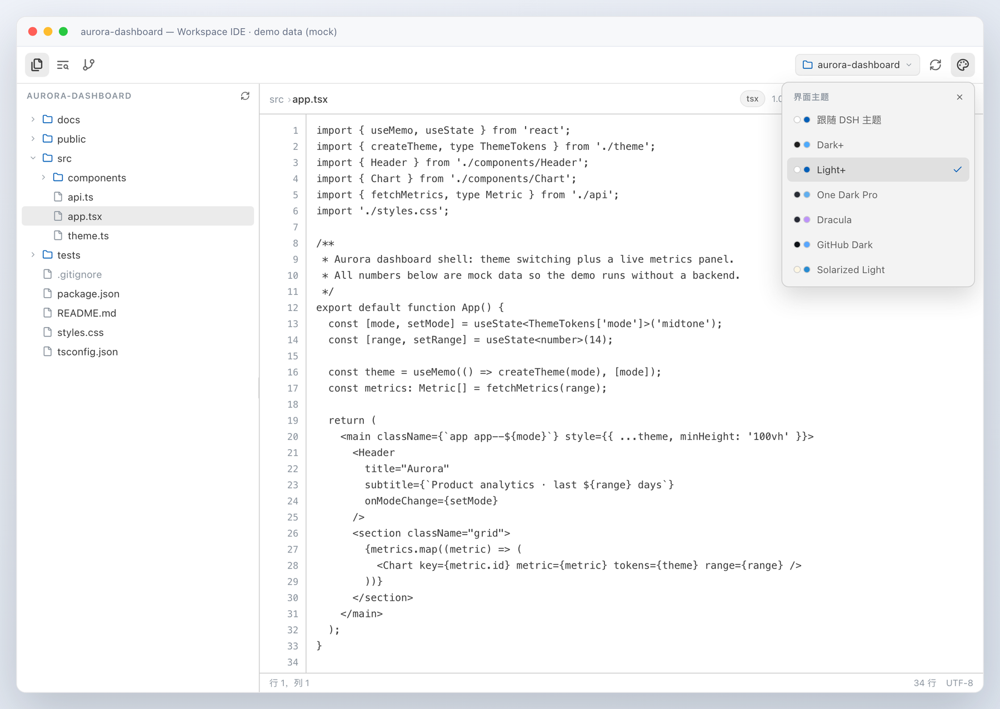

# dsh-workspace-ide

[](https://github.com/echoVic/dsh-workspace-ide/actions/workflows/test.yml)
[](https://www.npmjs.com/package/dsh-workspace-ide)
[](LICENSE)

[English](README.md) | 简体中文

给 [DeepSeek Harness](https://github.com/deepseek-ai/deepseek-harness)（DSH）用的类 VS Code 工作区面板插件：不用离开对话，就能浏览工作区、搜索它、查看它的 git 状态。

它发布在 npm 上：[`dsh-workspace-ide`](https://www.npmjs.com/package/dsh-workspace-ide)。每个版本都由 GitHub Actions 通过 npm trusted publishing（OIDC）构建并发布，附带签名来源证明。



## 面板

- **文件**：整个工作区的懒加载目录树，可拖动分栏；带行号、语法高亮的查看器，装订线里显示 git 变更标记。快速打开（`Ctrl/Cmd+P`）、文件内查找替换（`Ctrl/Cmd+F` / `Ctrl/Cmd+H`，支持大小写、全词和正则）、多标签编辑（每个标签保留草稿并拦截未保存关闭）、前进后退（`Ctrl/Cmd+Alt+←/→`）、编辑器缩放、括号匹配、自动配对、缩进参考线和整行移动、`Cmd/Ctrl+/` 切换注释、Markdown 预览与源码切换、图片和 SVG 预览，以及大文件和二进制保护。`Ctrl/Cmd+S` 保存。
- **搜索**：全工作区全文搜索，支持大小写、正则、全词和 include 过滤；命中按文件分组、高亮，点击直接跳到对应行。
- **Git**：类 PyCharm 的提交（Commit）面板，支持勾选本次要提交的文件（已跟踪改动默认勾选、未跟踪文件默认不勾选）、点击预览彩色 unified diff、单文件/分组/批量暂存、取消暂存和将未跟踪文件加入 Git，以及仅提交已选改动的本地提交流程（`Cmd/Ctrl+Enter` 快捷提交，保留未勾选改动）；同时展示当前分支、ahead/behind 和带逐提交 diff 的历史。标签页打开时状态和日志静默刷新，隐藏时暂停；保存后刷新装订线标记。非 git 工作区会列出其他工作区，一键切换。
- **字体大小**：工具栏提供「字体大小」弹出面板，可分别调整界面字号（覆盖文件树、标签页、搜索结果、Git 面板和弹窗）与编辑器字号，支持加减步进、直接输入、快捷预设、即时生效、重启保留和一键恢复默认。

### 配色主题

面板自带主流的 VS Code 配色，切换时不影响 DSH 其余界面：**跟随 DSH 主题**（默认，直接取 `--dsw-alias-*` 的值）、**Dark+**、**Light+**、**One Dark Pro**、**Dracula**、**GitHub Dark** 和 **Solarized Light**。



README 里的截图都由合成的演示工作区渲染。

## 安装

在 DSH 会话里安装已发布的 npm 包（可指定版本）：

```text
plugin_manager {
  action: "install_bundle",
  target: "dsh-workspace-ide"
}
```

也可以直接从 GitHub 安装（`main` 或固定版本的 tarball）：

```text
plugin_manager { action: "install_bundle", target: "echoVic/dsh-workspace-ide" }
plugin_manager { action: "install_bundle", target: "https://github.com/echoVic/dsh-workspace-ide/archive/refs/tags/v1.8.7.tar.gz" }
```

开发插件时，用绝对路径安装工作目录：

```text
plugin_manager { action: "install_bundle", target: "/absolute/path/to/dsh-workspace-ide" }
```

Bundle 是 profile 级的，重启后仍然有效。结果显示 `application: "applied"` 表示已立即激活；客户端改动由 DSH 的 client HMR 接收，Host 改动在下次 Host 启动时加载。

## 平台说明

Host 端按平台原生写法校验工作区根目录，Windows 盘符和 UNC 路径都能用，win32 反斜杠会归一化为 POSIX 分隔符。快捷键提示统一写 **Cmd/Ctrl**；排版沿用 DSH 的 `--dsw-font-family` 和 `--ds-font-family-code`，DSH 的字体设置对面板同样生效。

## 实现

- **Host**（`lib/index.js`、`lib/host/*.js`）通过 `ctx.connection.fetch.register` 注册 10 条需要认证的 fetch 路由；文件系统访问会做路径检查，除 `save`（只原子覆盖已存在的普通文件）、`git-action`（本地暂存/取消暂存/提交）和 `ping` 外都是只读。Git 通过 `child_process.execFile` 执行并限制输出。
- **Client**（`lib/client.js`，由 `scripts/build-client.mjs` 从 `src/client/` 生成）是一个 `window.__ModuleLoader__.load(...)` 模块，注册 `sidebar.panellist` 图标和对应的 `main` 面板，只依赖 `require('react')`、DSH 主题 token 和内置的中英文字典。
- **图标**来自开源 [Lucide](https://lucide.dev)，以 SVG 数据内置，没有运行时依赖；许可见 [THIRD_PARTY_NOTICES.md](THIRD_PARTY_NOTICES.md) 和 [licenses/lucide-LICENSE.txt](licenses/lucide-LICENSE.txt)。

## 开发

```bash
npm ci                                 # 只装开发用的 TypeScript 检查器
npm run typecheck                      # tsc --checkJs，strict，覆盖 lib/、src/client、scripts 和测试
npm run typecheck:host                 # lib/ 额外开启 noImplicitAny
npm run typecheck:client               # 客户端源码开启 noImplicitAny
node scripts/build-client.mjs          # 从 src/client/ 重建 lib/client.js
node scripts/build-client.mjs --check  # lib/client.js 过期就失败
node --check lib/client.js
node --test test/host/                 # Host 路由单元测试
node test/smoke/client-smoke.mjs       # 无头客户端模块冒烟测试
python3 scripts/check-screenshots.py   # README 截图必须是有效渲染
```

TypeScript 只作为开发期检查器：源码是带 JSDoc 注释的普通 JavaScript，用 `tsc --noEmit --checkJs` 加 `strict: true` 检查。没有客户端打包器、Host 构建步骤或运行时依赖。`lib/client.js` 由 Host 直接提供，DSH 的 client HMR 会监听它，重新构建后保存即可热更新已打开的页面。

## 发布

推送 `v*` 标签会运行 [`.github/workflows/publish.yml`](.github/workflows/publish.yml)：标签必须和 `package.json` 一致，然后通过 GitHub OIDC trusted publishing 执行 `npm publish`（仓库里不放 npm token），并记录构建来源。

## 许可

[MIT](LICENSE)
